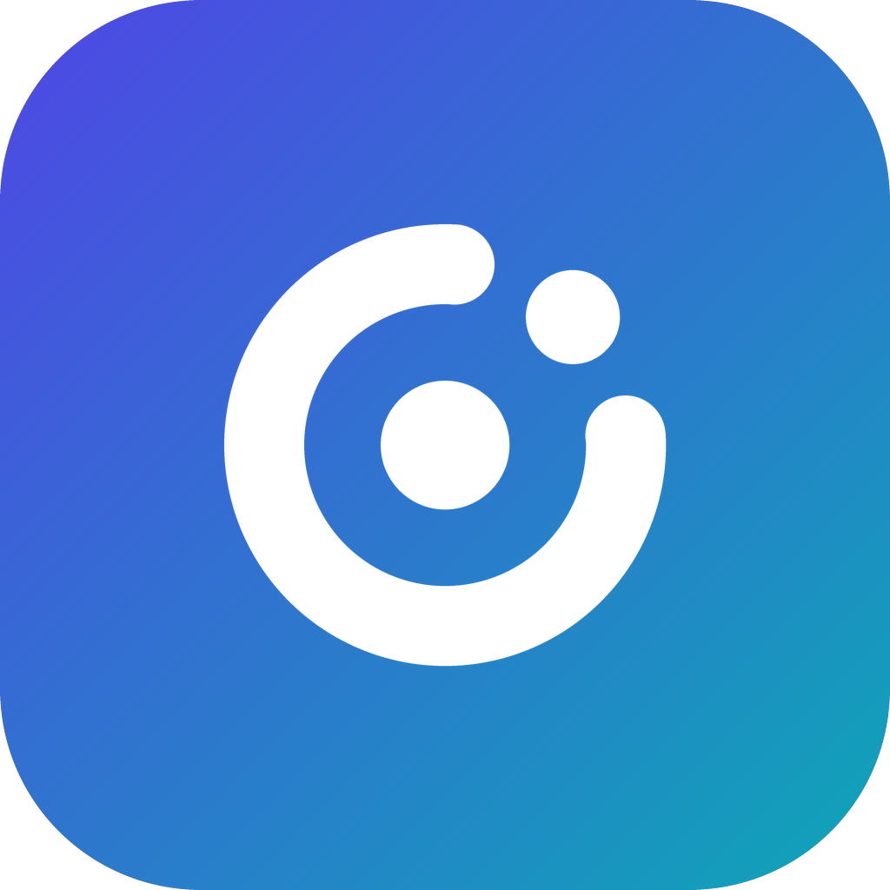

<h1>
  
  Plezilo — a Silo-capable fork of Plezy
</h1>

A client for Plex, Jellyfin, Emby, and [Silo](https://github.com/Silo-Server/silo-server) on desktop, mobile, and TV, built with Flutter.

Plezilo is based on [Plezy](https://github.com/edde746/plezy) by edde746 and adds Silo as a fourth server type. It is not made or endorsed by the Plezy project; report problems with Plezilo here, not upstream. Plezy's name, logo and services belong to the Plezy project ([TRADEMARKS.md](TRADEMARKS.md)), so Plezilo has its own name, icon and `plezilo://` links, and the features that relied on Plezy's services are switched off (see [What is switched off](#what-is-switched-off)).

<p>
  <a href="#download">Download</a> ·
  <a href="#silo-support">Silo support</a> ·
  <a href="CONTRIBUTING.md">Contributing</a> ·
  <a href="LICENSE">License</a>
</p>

## Download

Plezilo is published as pre-releases on [GitHub Releases](https://github.com/edrock200/plezo/releases) (`silo-preview-<version>` tags). It is not in any app store.

| Platform | Download |
| --- | --- |
| Android, Android TV, Fire TV | Always the newest preview: [armeabi-v7a](https://github.com/edrock200/plezo/releases/download/plezilo-android-latest/plezilo-armeabi-v7a.apk) (every Fire TV, most TV sticks; 32-bit) · [arm64-v8a](https://github.com/edrock200/plezo/releases/download/plezilo-android-latest/plezilo-arm64-v8a.apk) (64-bit phones, tablets, newer TV devices) · [x86_64](https://github.com/edrock200/plezo/releases/download/plezilo-android-latest/plezilo-x86_64.apk) (emulators) |
| Windows 10/11 (x64, ARM) | Installer and portable `.7z` on each [release](https://github.com/edrock200/plezo/releases) |
| macOS (Apple silicon, Intel) | `.dmg` on each [release](https://github.com/edrock200/plezo/releases) |

Fire TV Downloader codes: **5985619** (32-bit, every Fire TV) and **8032572** (64-bit). Keep using the code you installed with: the 32-bit APK cannot update a 64-bit install. Plezilo installs as a new app (`com.edrock200.plezilo`) beside Plezy and beside the older "Plezy with Silo" previews: sign in again in Plezilo, then uninstall the old one.

iOS, tvOS and Linux build from this source but are not published.

### What is switched off

These features used services the Plezy project runs or registered, which a fork may not use. They stay off until Plezilo has its own (one switch: `lib/services/plezy_server.dart`):

- Trakt, MyAnimeList, AniList, Simkl and MDBList sync, ratings and scores
- Discord rich presence
- Log upload (copying logs still works)
- Crash reports

## Features

###  Browse & Discover
- Libraries, collections, and playlists — video and audio
- Shuffle a whole movie or TV library
- Discover hub — Continue Watching, Next Up, trending, and recommendations
- Continue Watching shows a title held in several libraries or on several servers once, and asks which copy to play
- Cross-server search across every connected Plex, Jellyfin, Emby, and Silo server, including actors and directors
- Filtering, sorting, and alphabetical jump navigation
- Folder browsing and folder playback — home-video libraries open in folder view
- Resolution, HDR/Dolby Vision, and audio-format badges on cards and detail pages
- Favorites and unwatched library filters[^mb]
- Extras — trailers, deleted scenes, behind-the-scenes

###  Explore & Requests
- Explore tab — watchlist, trending, popular, and recommendation rows from Plex Discover[^plex] and Seerr[^connect]
- Search any connected catalog source
- Catalog titles matched back to your own libraries by external ID
- Seerr — request movies and shows with per-season, 4K, and advanced destination options, and see request status inline
- Watchlist sync — add and remove titles on your Plex watchlist from anywhere in the app

###  Playback
- Wide codec support (HEVC, AV1, VP9, and more)
- HDR and Dolby Vision[^hdr]
- Direct play, or transcode presets from 240p/320 kbps to 1080p/20 Mbps
- Multi-version switching with per-version file details
- Full ASS/SSA subtitles with customizable styling
- Online subtitle search & download[^plex]
- Audio & subtitle choices remembered per title, or follow the server's per-episode selections
- Progress sync and resume
- Auto-play next episode with skip intro / skip credits
- Chapter navigation with thumbnail scrub previews
- Playback speed from 0.25x to 8x, audio sync offset, sleep timer (fixed durations or end of video)
- Video zoom 50-200% with pinch, presets, and hotkeys
- Audio passthrough[^pass], output channel limit (5.1 or stereo, with center-channel boost), and loudness normalization
- File Info sheet — every version, file, and stream the server reports
- Ambient lighting and GLSL shader presets[^mpv]
- Picture-in-Picture[^pip]
- Refresh-rate matching[^rrm]
- External player launch (VLC, MX Player, etc.) with progress sync back[^android]

###  Music
- Music libraries — artist, album, and track browsing with square artwork
- Album and artist screens with play, shuffle, and Instant Mix
- Gapless playback with a full play queue — reorder, remove, play next, add to queue
- Now Playing with synced lyrics[^lyrics], persistent mini-player, and sleep timer
- Background playback with lock-screen, media-key, and notification controls[^bgaudio]
- Offline playback of downloaded albums and tracks
- Streaming quality presets — Original, 320, 192, or 128 kbps

###  Live TV & DVR
- Live TV channel browsing, tuning, and favorites
- EPG guide with What's On and per-show schedules
- DVR recording rules, scheduled recordings, and a rememberable recording target library[^plex]
- Multi-server Live TV support where available

###  Downloads & Offline
- Download movies, shows, and music for offline playback[^dl]
- Background queue with pause / resume
- Sync rules for automatic downloads, with per-show "Include Specials"
- Offline browsing with watch state sync-back on reconnect

###  Watch Together
- Rooms on [Open Watch Party](https://openwatch.party) — share a six-character code; friends join from Plezilo, Plezy or another Open Watch Party app
- Everyone plays their own copy from their own server — Plex, Jellyfin, or Emby — matched by catalogue IDs, with a picker when several copies fit
- Synchronized play / pause / seek, host or shared control, room lock, and host handoff
- Public relays by default, or point Plezilo at your own self-hosted relay

###  Integrations
- Seerr requests
- Companion remote — control desktop and TV from mobile
- Discord Rich Presence and Trakt, MyAnimeList, AniList, Simkl and MDBList are switched off in Plezilo ([why](#what-is-switched-off))
- Watch Next row and tvOS Top Shelf[^shelf]
- [`plezilo://` links](#plezilo-links) to open a profile, play a title, or tune a channel from Home Assistant, launchers, or an NFC tag; any movie, show, or episode menu shows its link[^links]

###  Platform & Customization
- Desktop, mobile, and TV — full D-pad, keyboard, and gamepad support
- Multiple servers at once — Plex, Jellyfin, Emby, and Silo side by side
- Silo servers over Silo's `/api/v2` API: sign in with a code or password, Silo profiles with PINs, server-defined Home rows, and server-chosen Direct Play or transcode[^silo]
- Profiles with per-profile downloads, watch state, and settings; Plex Home switching with PIN
- Jellyfin and Emby local-server discovery and multiple URLs per server; Quick Connect sign-in[^jf]
- TV layout options — corner spotlight backdrop, full-card artwork, and Force TV mode on desktop
- Customizable keyboard shortcuts[^desktop]
- Metadata and artwork editing
- Settings import/export
- Localized in English plus 21 translations

[^jf]: Jellyfin only.
[^mb]: Jellyfin and Emby only.
[^plex]: Plex only.
[^silo]: Silo support covers movies and TV shows, including downloads of the original file. Playlists, live TV, music and audiobooks are not available for Silo servers yet.
[^connect]: Requires connecting the service under Settings > Services.
[^hdr]: In-app HDR toggle on Windows, macOS, iOS, tvOS, and Linux — Linux needs a colour-managed Wayland compositor. Dolby Vision on Android, macOS, and Apple TV.
[^pass]: Desktop, Android TV, and Apple TV.
[^mpv]: Requires the mpv player backend — Android defaults to ExoPlayer. Not applied to Dolby Vision on Apple platforms.
[^pip]: Android, iOS, and macOS — not on Android TV or Apple TV.
[^rrm]: Windows, Android, and tvOS.
[^android]: Progress sync on Android.
[^lyrics]: Where your server provides lyrics.
[^bgaudio]: tvOS pauses music when the app is backgrounded.
[^dl]: Not available on tvOS.
[^desktop]: Desktop only.
[^shelf]: Android TV / Fire TV and tvOS.
[^links]: Android, iOS, macOS, and tvOS.

## plezilo:// links

Links start Plezilo from outside the app. Any link may add `profile=<profile>`: a profile id, a Plex Home user UUID, or a display name (ignoring case; it must match one profile). Plezilo switches to that profile first, and a protected profile still asks for its PIN. A link replaces whatever is playing.

| Link | Does |
|---|---|
| `plezilo://open` | Opens Plezilo |
| `plezilo://play?server=<server>&id=<item>` | Plays one item on one server, any backend |
| `plezilo://play?type=movie\|show&tmdb=<n>` | Plays a title from whichever server has it. Use `tmdb`, `tvdb`, `imdb=tt<n>`, or `plex=<hash>` (the Plex GUID without `plex://movie/`) |
| `plezilo://live?channel=<channel>` | Tunes a Live TV channel by key, number, or call sign. Optional `server=<server>` and `start=beginning\|live` |

For a show, `mode=next` (the default) plays the next episode to watch, and `mode=shuffle` plays the show shuffled. The menu of any movie, show, or episode has **Show link**, and each profile's menu in **Switch Profile** has **Show profile link**. Both show the link as text and a QR code.

```sh
# Android / Android TV, over adb (Home Assistant: remote.turn_on with activity: plezilo://...)
adb shell am start -a android.intent.action.VIEW -d "plezilo://play?type=show\&tvdb=81189\&profile=Kids"
# macOS
open "plezilo://play?type=movie&tmdb=603"
```

On iOS, use the Open URLs action in Shortcuts.

## Silo support

Plezilo adds [Silo](https://github.com/Silo-Server/silo-server) as a fourth server type, next to Plex, Jellyfin and Emby, on phones, tablets, desktop and TV. Plezilo talks to Silo only through its `/api/v2` API, the same surface Silo's Android and Android TV apps use.

### Getting the Android preview

The newest Android preview is always at the same links, so they can be typed into a TV:

| Device | Fire TV Downloader code | Direct link |
| --- | --- | --- |
| Every Fire TV, most Android TV sticks (32-bit) | **5985619** ([aftv.news/5985619](http://aftv.news/5985619)) | [plezilo-armeabi-v7a.apk](https://github.com/edrock200/plezo/releases/download/plezilo-android-latest/plezilo-armeabi-v7a.apk) |
| 64-bit phones, tablets and newer TV devices | **8032572** ([aftv.news/8032572](http://aftv.news/8032572)) | [plezilo-arm64-v8a.apk](https://github.com/edrock200/plezo/releases/download/plezilo-android-latest/plezilo-arm64-v8a.apk) |
| Emulators and x86 devices | | [plezilo-x86_64.apk](https://github.com/edrock200/plezo/releases/download/plezilo-android-latest/plezilo-x86_64.apk) |

Keep using the code or link you installed with. Each APK has its own version numbers and the 64-bit one's are higher, so Android will not let the 32-bit APK update an install of the 64-bit one. To switch from 64-bit to 32-bit, uninstall Plezilo first (this removes its saved servers and downloads).

The old Downloader codes (7329550, 4196538) and `silo-android-latest` links serve the last "Plezy with Silo" preview and are no longer updated. Windows and macOS builds are on each numbered `silo-preview-*` release.

### Connecting

1. Choose **Add connection › Connect to Silo** (or **Connect to Silo** on the first-run sign-in screen).
2. Enter the server address. A bare host is tried as `https://`, then `http://`, then `http://host:8090` (Silo's default port). A reverse-proxy path prefix such as `https://example.com/silo` works.
3. Sign in:
   - **With a code** (the default on TVs): the screen shows a code and a QR code; approve it from Silo on your phone or the web.
   - **With username and password**, when the server allows password sign-in (local accounts or LDAP-style providers).
4. Pick a **Silo profile**, entering its PIN if it has one. Each Silo profile you add is its own connection, so add the server again to use another profile, or attach it to a different Plezilo profile.

### Server requirements

- A Silo server with the `/api/v2` API. Playback needs playback protocol v3 with sequenced progress (`sequenced_progress_v1`), the same requirement as Silo's own apps; on an older server, titles browse but do not play.
- Downloads need the server's direct-download links (`POST /api/v2/direct-download/links`); without them Plezilo says downloads need a newer server.

### What works

- **Home:** the rows your Silo server defines, including Continue Watching with next-up episodes (items can be dismissed).
- **Libraries:** movie, TV and mixed libraries, paged straight to any position (no loading every page before it), with sorting (title, date added, release date, year, rating, runtime, random), genre and age-rating filters, the A–Z bar, and the library's collections.
- **Details:** series, seasons and episodes, cast and crew with person pages, ratings (IMDb, TMDB, Rotten Tomatoes), and More Like This.
- **Search** for titles and people.
- **Playback:** Plezilo tells the server what the player can play and the server chooses Direct Play or a transcode (Silo playback protocol v3). Quality presets cap the bitrate; subtitles, skip intro/credits markers and chapters work; progress is saved to the server as you watch.
- **Watched, favorites and 1–5 star ratings**, on movies, series, seasons (also from an episode's season link) and episodes.
- **Subtitle search and "Translate with AI"** in the player's subtitle menu: the server searches its subtitle providers or makes AI subtitles (from a subtitle or an audio track) and stores them, and Plezilo switches to the result. Subtitles stored on the server are listed with the file's own.
- **Downloads** of the original file for offline playback, including external subtitle files, artwork, markers and chapters. Progress from a downloaded file syncs back when you reconnect.

### Not yet supported for Silo

Music, audiobooks and e-books (those libraries are hidden), playlists, live TV, seek-preview thumbnails, metadata editing, library scans, sign-in through a browser (OIDC) or a network identity provider, and Silo's server-side download registry (downloads made by Plezilo do not appear in Silo's download list). Sign-in tokens refresh automatically, but a video watched for longer than the server's access-token lifetime (usually an hour) may fail to seek near the end.

### Troubleshooting

- **Signed out / auth error banner:** the server refused the saved sign-in (expired or revoked session). Remove the Silo connection and add it again.
- **"Profile verification required":** the Silo profile has a PIN; re-add it and enter the PIN.
- **"Playback not allowed":** the server has playback disabled for this account, or predates playback protocol v3 with sequenced progress.
- **"Downloads need a newer server":** the server has no direct-download links.

### Preview builds

Plezilo previews are published as [pre-releases](https://github.com/edrock200/plezo/releases):

- **Android:** `arm64-v8a` for most phones, tablets and Android TV boxes; `armeabi-v7a` for older or 32-bit devices such as Chromecast with Google TV; `x86_64` for emulators. Plezilo is its own app (`com.edrock200.plezilo`) and installs beside Plezy. Later previews install over earlier ones as updates only while they share a signing key: with the repository's `ANDROID_*` signing secrets always, otherwise only for builds of the same branch within about a week (the key lives in the GitHub Actions cache). If an update is refused, uninstall the previous preview first; each build compares its signing key with the previous preview's and says so at the top of its notes when it changed.
- **macOS:** a `.dmg` for Apple silicon and Intel Macs. It is not signed by Apple (allow it once in System Settings › Privacy & Security › Open Anyway) and never updates itself.
- **Windows:** a Windows 10/11 installer (x64 and ARM) and portable `.7z` downloads. They are not code-signed (SmartScreen may warn) and never update themselves.
- Each preview adds 0.1 to the last one's number (2.27.0, 2.28.0, …), so the number no longer says which Plezy version a preview is based on. The app's About screen shows the same number.
- A push to a `ccr-*` or `silo/*` branch whose commit message's first line contains `[release-apk]` builds and publishes a new preview (`.github/workflows/silo-preview-apk.yml`). A newer push to the same branch cancels a build still in progress, so wait for the release (and its Windows files) before pushing again.

### Changes in this fork

The full, plain-language change log for each preview is in [`docs/silo-preview-changelog.md`](docs/silo-preview-changelog.md) and on each release page.

- **First preview:** Silo as a fourth backend — sign-in, profiles and PINs, browsing, search, playback protocol v3, progress, watched/favorite/rating, downloads.
- **Phone and TV parity with Silo's apps:** tablets identify as tablets, playback reports the device's form factor and metered networks, Silo's default port `8090` is tried, LDAP-style password sign-in, downloads never carry the account token.
- **Review fixes:** cursor paging that jumps to distant pages and recovers from changed listings; season writes from an episode's season link no longer hit the whole series; failed playback stops are retried; refused sign-ins are not retried on every request; offline details for downloaded items; faster Home and season loading; Continue Watching dismissals, IMDb scores and version runtimes fixed; Discord artwork no longer receives the account token; device-code sign-in handles expired codes, PIN lockouts and broken avatars; each Plezilo profile's downloads stay with its own Silo account.


## Building from Source

### Prerequisites
- Flutter SDK 3.47.0+
- A Plex account, or a Jellyfin, Emby, or Silo server with user credentials

### Setup

```bash
git clone https://github.com/edrock200/plezo.git
cd plezo
flutter pub get
scripts/codegen.sh
flutter run
```

<details>
<summary>Code generation</summary>

After modifying model classes or other generated sources:

```bash
scripts/codegen.sh
```

After modifying translations:

```bash
dart run slang
```

</details>

<details>
<summary>Packaging a Flatpak bundle</summary>

Packages an **already fully resolved Linux release bundle** — pinned libmpv and bundled libraries included, not a Flathub source-build manifest. Run it on Linux, on the same architecture as the bundle, after following the bundle preparation steps in [the Linux release workflow](.github/workflows/build.yml): `flutter build linux` alone does not produce all the required bundled libraries.

Install the packaging tools (Debian/Ubuntu shown) plus the native-architecture SDK and runtime:

```bash
sudo apt-get update
sudo apt-get install -y flatpak flatpak-builder imagemagick
flatpak remote-add --user --if-not-exists flathub https://flathub.org/repo/flathub.flatpakrepo
flatpak install --user flathub org.freedesktop.Platform//25.08 org.freedesktop.Sdk//25.08

BUNDLE_DIR=build/linux/x64/release/bundle
python3 linux/packaging/build-flatpak.py --bundle "$BUNDLE_DIR" --arch x64 --output "$PWD"
```

That writes `plezilo-linux-x64.flatpak`, installable with the Flatpak commands above; on arm64, use the prepared arm64 bundle directory and `--arch arm64`. Package from the checkout matching the bundle, since the version comes from `pubspec.yaml`.

Cross-architecture packaging needs native Flatpak tools, a registered binfmt interpreter, and the target SDK/runtime installed with `flatpak install --user --arch=x86_64` (or `aarch64`) — never run Flatpak's namespace tools under emulation. Pass `--arch x64` or `--arch arm64` to the checker and the matching Flatpak architecture to `flatpak run --arch=...`.

Check the installed package against the runtime (not just the SDK), then launch it on a Wayland desktop and exercise streaming, audio, downloads/offline playback, and file chooser portals:

```bash
python3 linux/packaging/check-flatpak.py
```

The check fails on a non-executable entry point or an unresolved bundled ELF dependency. A container without a GPU can use `flatpak run --env=GALLIUM_DRIVER=softpipe com.edrock200.plezilo` for software-rendered verification; this is not a hardware-decoding or HDR test.

</details>

<details>
<summary>Local checks</summary>

```bash
scripts/ci_checks.sh
```

To install the same pre-commit checks locally:

```bash
scripts/setup_hooks.sh
```

End-to-end tests (Android emulator plus a Dockerized Jellyfin fixture):

```bash
python3 scripts/maestro/run_maestro.py basic
```

</details>

## Contributing

See [CONTRIBUTING.md](CONTRIBUTING.md) for development workflow, formatting, tests, and translation guidelines.

## License

Plezilo, like Plezy, is licensed under [GPL-3.0](LICENSE). The license covers the code, not the Plezy name or logo ([TRADEMARKS.md](TRADEMARKS.md)); Plezilo uses neither. Plezilo is based on Plezy by [@edde746](https://github.com/edde746) and is not made or endorsed by the Plezy project.

## Acknowledgments

- Built with [Flutter](https://flutter.dev)
- Supports [Plex Media Server](https://www.plex.tv), [Jellyfin](https://jellyfin.org), [Emby](https://emby.media), and [Silo](https://github.com/Silo-Server/silo-server)
- Silo support follows Silo's own [Android and Android TV apps](https://github.com/Silo-Server/silo-android) and the [Siku](https://github.com/edrock200/Siku) Roku client. Plezilo is not made or endorsed by Silo Media L.L.C.; "Silo" and the Silo logo are their trademarks, used here only to name the server Plezilo connects to. The Silo server badge is Silo's official, unmodified project icon, included as Silo's trademark policy allows for projects that work with Silo (© 2026 Silo Media L.L.C., not covered by Plezilo's license; see `assets/brand/silo/NOTICE.txt`).
- Playback powered by [mpv](https://mpv.io) via our [mpv-build](https://github.com/edde746/mpv-build) pipeline (started as a fork of [MPVKit](https://github.com/mpvkit/MPVKit); on Android through its mpv-android library, whose Kotlin/JNI glue descends from [libmpv-android](https://github.com/jarnedemeulemeester/libmpv-android)), Android [ExoPlayer](https://developer.android.com/media/media3/exoplayer), and [libass-android](https://github.com/peerless2012/libass-android)
